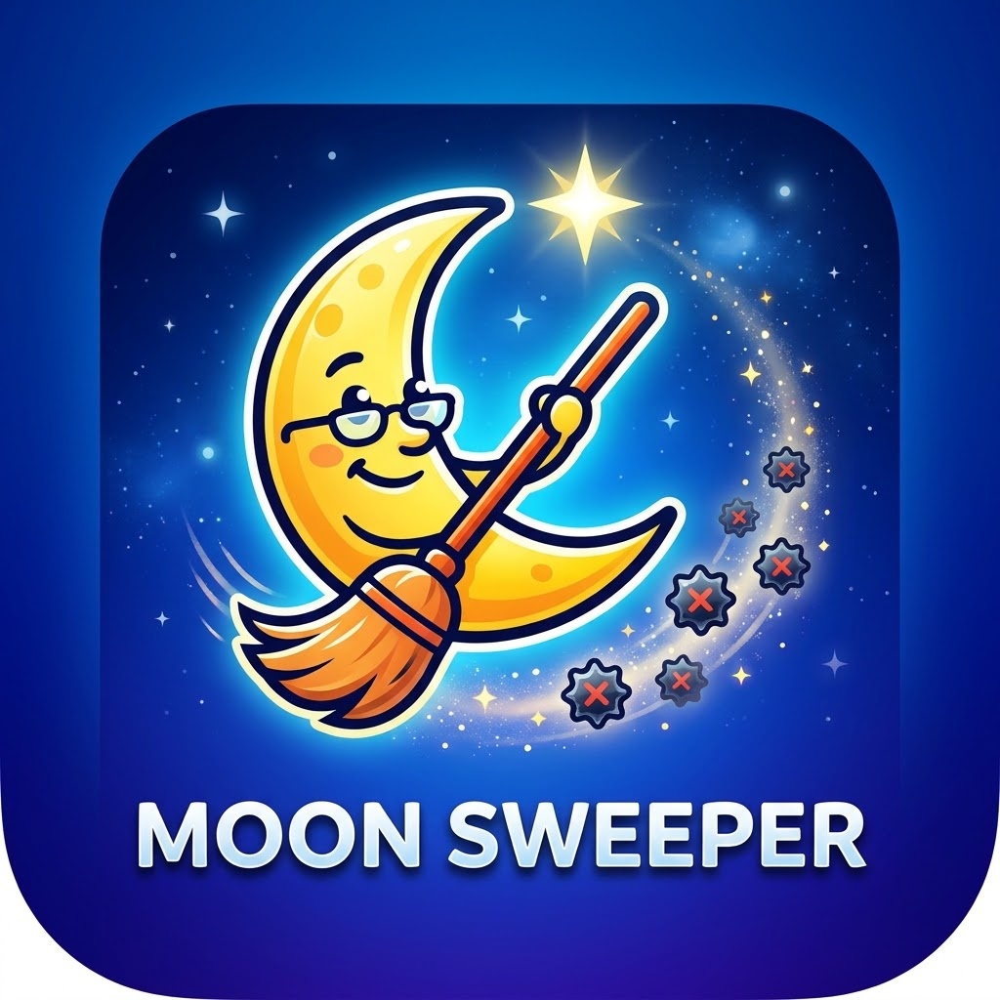

<div align="center">



# NoFocusLoss

**Keep driving while you alt-tab: a Moon Sweepers mod**

[](https://github.com/Yukitus86/MoonSweepers-NoFocusLoss/releases/latest)
[](https://github.com/Yukitus86/MoonSweepers-NoFocusLoss/releases)
[](#compatibility)
[](#linux--steam-deck-proton)
[](LICENSE)

[**Download**](https://github.com/Yukitus86/MoonSweepers-NoFocusLoss/releases/latest) ·
[Installation](#installation) ·
[Configuration](#configuration) ·
[Troubleshooting](#troubleshooting) ·
[Report a bug](https://github.com/Yukitus86/MoonSweepers-NoFocusLoss/issues/new/choose)

</div>

---

In vanilla Moon Sweepers your vehicle **stops as soon as the game window loses focus**: Alt+Tab, clicking a second
monitor, opening Discord or a browser. **NoFocusLoss** hides that focus loss from the game, so your vehicle keeps going
on cruise control, autopilot or held keys while you do something else.

## Features

| | |
|---|---|
| 🚗 **Keeps the game running** | Nothing pauses, input isn't reset, nothing calls `OnApplicationFocus(false)` |
| 📦 **No mod loader** | One DLL. No BepInEx or MelonLoader needed |
| 🖱️ **Mouse stays free** | The cursor is never locked to the game window while you're tabbed out |
| ⌨️ **No ghost input** | Typing in other windows never steers your vehicle |
| ⚙️ **Configurable** | Plain `.ini` file, every feature can be switched off |
| 🧹 **Clean uninstall** | Delete two files and the game is vanilla again |

## Installation

1. **Download** `NoFocusLoss-MoonSweepers-vX.Y.Z.zip` from the
   [latest release](https://github.com/Yukitus86/MoonSweepers-NoFocusLoss/releases/latest).
2. **Open the game folder.** In Steam, right-click **Moon Sweepers**, then choose **Manage** → **Browse local files**.
3. **Extract** `version.dll` and `NoFocusLoss.ini` into that folder, next to `MoonSweepers.exe`:

   ```text
   Moon Sweepers\
   ├── MoonSweepers.exe
   ├── UnityPlayer.dll
   ├── version.dll        ◄ from the mod
   ├── NoFocusLoss.ini    ◄ from the mod
   └── ...
   ```

4. **Start the game** through Steam as usual.

> [!TIP]
> Default game folder: `C:\Program Files (x86)\Steam\steamapps\common\Moon Sweepers`

### Verify

After starting the game, `NoFocusLoss.log` appears in the game folder:

```text
NoFocusLoss 1.0.0 loaded. Enabled=1 ...
USER32 hooks active in UnityPlayer.dll: 14
Game window attached (hwnd=...)
```

Alt-tab out of the game and this line is added:

```text
Focus loss hidden from game (WM_ACTIVATE) - game keeps running.
```

### Uninstall

Delete `version.dll`, `NoFocusLoss.ini` and `NoFocusLoss.log` from the game folder.

## Configuration

Edit `NoFocusLoss.ini` in the game folder (`1` = on, `0` = off) and restart the game afterwards.

| Setting | Default | Description |
|---|:---:|---|
| `Enabled` | `1` | Turns the whole mod on or off. |
| `KeepHeldKeys` | `1` | Keys you hold while tabbing out (e.g. **W**) stay pressed in game. Alt/Ctrl/Shift/Win/Tab are always released. With `0`, only cruise control or autopilot keeps driving. |
| `BlockBackgroundInput` | `1` | Typing or clicking in other windows never controls the game. |
| `ReleaseCursor` | `1` | The mouse is never locked to the game window while it's in the background. |
| `Log` | `1` | Writes `NoFocusLoss.log` to the game folder. |

## Compatibility

| Platform | Status |
|---|---|
| Windows 10 / 11 x64 | ✅ Tested |
| Linux / Steam Deck (Proton) | ⚠️ Untested ([see below](#linux--steam-deck-proton)) |

| | |
|---|---|
| Game build | Steam release with Unity `6000.6.0f1` (IL2CPP, metadata v108) |
| Display mode | Windowed or Borderless Fullscreen recommended |
| Multiplayer | Client-side only. Each player installs it for themselves |

### Linux / Steam Deck (Proton)

Untested. Proton uses its own `version.dll` unless you tell it to load the game's copy. Install the files as above,
then set this in Steam → Moon Sweepers → **Properties** → **Launch Options**:

```text
WINEDLLOVERRIDES="version=n,b" %command%
```

If you try this, please report back in an [issue](https://github.com/Yukitus86/MoonSweepers-NoFocusLoss/issues).

## Troubleshooting

<details>
<summary><b>No <code>NoFocusLoss.log</code> appears</b></summary>

- Make sure `version.dll` is directly next to `MoonSweepers.exe` and not in a subfolder.
- Make sure `Log=1` is set in `NoFocusLoss.ini`.
- On Linux/Proton, set the launch option shown above.

</details>

<details>
<summary><b>The game still minimizes when I alt-tab</b></summary>

Switch to **Windowed** or **Borderless Fullscreen** in the game's settings. Exclusive fullscreen is handled by the
graphics driver.

</details>

<details>
<summary><b>A key is "stuck" after I come back</b></summary>

That's `KeepHeldKeys=1` working as intended. The key you held while tabbing out is still pressed in game. Tap it once,
or set `KeepHeldKeys=0`.

</details>

<details>
<summary><b>My antivirus flags <code>version.dll</code></b></summary>

DLL proxies sometimes trigger heuristic false positives. Release builds come straight from the public source through
[GitHub Actions](https://github.com/Yukitus86/MoonSweepers-NoFocusLoss/actions), so you can read the code or
[build it yourself](#building-from-source).

</details>

<details>
<summary><b>It stopped working after a game update</b></summary>

Open an [issue](https://github.com/Yukitus86/MoonSweepers-NoFocusLoss/issues/new/choose) and attach your
`NoFocusLoss.log`.

</details>

## FAQ

**Can I get banned?**
The mod only changes how the game window reacts to focus changes on your own PC. It doesn't touch game files, memory
values, saves or network traffic, and Moon Sweepers has no anti-cheat. As with any mod, use it at your own risk.

**Why `version.dll`?**
Unity's `UnityPlayer.dll` loads `version.dll`, and Windows checks the game folder first. The mod passes every real
`version.dll` function through to `C:\Windows\System32\version.dll`, so nothing breaks. Many mods and mod loaders use
this "DLL proxy" technique.

**Why not BepInEx?**
Moon Sweepers uses Unity 6000.6 with IL2CPP metadata v108, which BepInEx doesn't officially support yet. A native DLL
works whatever the IL2CPP version.

## How it works

```text
MoonSweepers.exe
 └─ UnityPlayer.dll ──loads──► version.dll (NoFocusLoss)
                                 ├─ forwards real API ──► System32\version.dll
                                 ├─ wraps Unity's window procedure
                                 └─ hooks USER32 imports of UnityPlayer.dll
```

1. **Window procedure.** The mod wraps the window procedure of `UnityWndClass` and swallows the "lost focus" messages
   `WM_ACTIVATE` (inactive), `WM_ACTIVATEAPP` (false) and `WM_KILLFOCUS`. The engine, the Input System and the game
   scripts never see the focus loss.
2. **Import hooks.** The mod replaces a few USER32 imports of `UnityPlayer.dll` in its import table:

   | Hook | Purpose |
   |---|---|
   | `GetForegroundWindow`, `GetActiveWindow`, `GetFocus` | Report the game window as focused |
   | `ClipCursor`, `SetCursorPos` | Ignored in background, so the mouse stays free |
   | `GetAsyncKeyState`, `RegisterRawInputDevices`, `WM_INPUT` | No background keyboard/mouse input |
   | `SetForegroundWindow`, `SetFocus`, `SetWindowPos`, `ShowWindow` | The game can't steal focus back or minimize itself |

3. **Safety.** The mod does nothing unless `UnityPlayer.dll` is loaded (for example, it stays idle in the crash
   handler), and it only blocks focus calls *after* it has hidden a real focus loss.

## Building from source

**Requirements:** Visual Studio 2022 or newer, with the **Desktop development with C++** workload.

```bat
git clone https://github.com/Yukitus86/MoonSweepers-NoFocusLoss.git
cd MoonSweepers-NoFocusLoss
build.bat
```

The output goes to `dist\`. Every push is built by GitHub Actions, and pushing a `v*` tag publishes a release
automatically.

<details>
<summary>Project layout</summary>

```text
src/NoFocusLoss.c          mod source (focus faking, hooks, version.dll forwarding)
src/version.def            export list of the proxy DLL
src/NoFocusLoss.rc         version resource
NoFocusLoss.ini            default config
build.bat                  build script (finds Visual Studio automatically)
.github/workflows/         CI build + automated releases
```

</details>

## License

Released under the [MIT License](LICENSE).

<sub>Not affiliated with or endorsed by the developers of Moon Sweepers.</sub>
